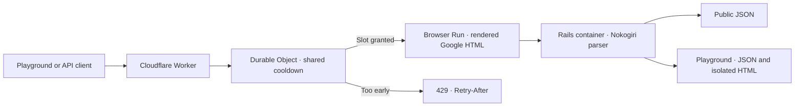

# Search Lab

Search Lab is a Rails playground for comparing a Google results page with the JSON a Nokogiri parser extracts from it. Open the playground to inspect **Ruby on Rails guides** without consuming a search slot. [Hosted playground](https://serp-api-demo.alexoliynyk.me/)

```sh
curl -sS 'https://serp-api-demo.alexoliynyk.me/example.json'
curl -i 'https://serp-api-demo.alexoliynyk.me/search.json?q=Ruby+on+Rails+guides'
```

The first command returns the labeled saved example. The second sends a live search. Google returned challenge pages on the three initial Browser Run checks. If that happens, the API returns `502 upstream_challenge` and the playground keeps the last successful HTML and JSON visible. The bundled example uses a small representative HTML fixture.

## Review the code

1. Follow [the Rails routes](config/routes.rb) and [search controller](app/controllers/search_controller.rb) to see how the API builds its response.
2. Read [the Nokogiri parser](app/services/google_search/parser.rb) beside [the HTML fixture](test/fixtures/google_search/example.html) and [parser tests](test/services/google_search_parser_test.rb). The parser requires explicit zero-results markup before returning an empty list. Otherwise an unrecognized page produces `unknown_layout`.
3. Read [the Worker](worker/search.mjs) and [cooldown tests](test/worker/search.test.mjs). One named Durable Object stores the next allowed search time, so the window survives container restarts and applies across visitors.
4. See [the preview sanitizer](app/services/google_search/preview.rb) and [browser tests](test/browser/playground.spec.mjs) for the HTML and JSON comparison flow.



The Worker also forwards the homepage and saved example to Rails without reserving a slot. One live request fetches one page. Rails builds the JSON and, for the playground only, sanitizes a preview from the same response.

## Run locally

A Docker build needs no Cloudflare credentials.

```sh
docker build -t serp-api-demo .
docker run --rm -p 3000:3000 serp-api-demo
```

Open [the local playground](http://localhost:3000/) or call `curl 'http://localhost:3000/search.json?q=Ruby+on+Rails+guides'`. Local mode serves that fixture query. Other queries get a fixture-mode error.

For development and checks, install the Ruby version in `.ruby-version` and Node 24.

```sh
bundle install
npm ci
npx playwright install chromium
bin/ci
```

`bin/ci` runs style checks, Rails static analysis, dependency audits, and the Ruby, Worker, and browser tests. For parser tests alone, run `bundle exec ruby test/services/google_search_parser_test.rb`. The automated suites use fixtures and mocked upstream requests.

## API contract

`GET /search.json` accepts one UTF-8 `q` parameter with 1–200 characters after trimming. Callers can make cross-origin GET requests and read `Retry-After` and `X-Request-Id`. The route requires no credentials. Live responses carry `Cache-Control: no-store`.

A shortened example response follows.

```json
{
  "query": "Ruby on Rails guides",
  "organic_results": [
    {
      "position": 1,
      "title": "Ruby on Rails Guides",
      "link": "https://guides.rubyonrails.org/",
      "snippet": "Documentation for Ruby on Rails, from getting started to deploying an application."
    }
  ],
  "request_id": "example-request",
  "elapsed_ms": 0,
  "source": "fixture"
}
```

A live response has `source: "google"` and up to ten first-page organic results. The snippet may be `null`. All searches share one slot every ten seconds. A failed upstream attempt still uses its slot.

| HTTP | Error code | Meaning |
| --- | --- | --- |
| 400 | `invalid_query` | Supply one valid query. |
| 405 | `method_not_allowed` | Use GET. |
| 429 | `rate_limited` | Wait for `Retry-After` seconds. |
| 502 | `upstream_challenge` | Google returned a challenge page. |
| 502 | `unknown_layout` | The parser could not recognize the page. |
| 503 | `upstream_unavailable`, `search_unavailable` | The upstream service or Rails container was unavailable. |
| 504 | `upstream_timeout` | Browser Run exceeded its navigation deadline. |

Errors include `error.code`, `error.message`, and `request_id`.

## Deploy

Authenticate Wrangler for a Workers Paid account with a Cloudflare zone for the configured hostname. Keep Docker running, install dependencies with `npm ci`, then run `npm run deploy`. Wrangler builds the Rails image, declares the Browser Run binding and SQLite-backed Durable Objects, and attaches the custom domain. Update the custom domain and Rails production host allowlist together if deploying under another hostname.

The container uses a per-process Rails secret for its stateless routes and sleeps after one minute of inactivity. The browser binding runs in the Worker, so the container needs no Internet access. Use the request ID to correlate Rails logs with the public response. The app does not add raw queries or captured HTML to its search logs.

Font licenses for [Inter](vendor/licenses/inter.txt) and [IBM Plex Mono](vendor/licenses/ibm-plex-mono.txt) are included.
